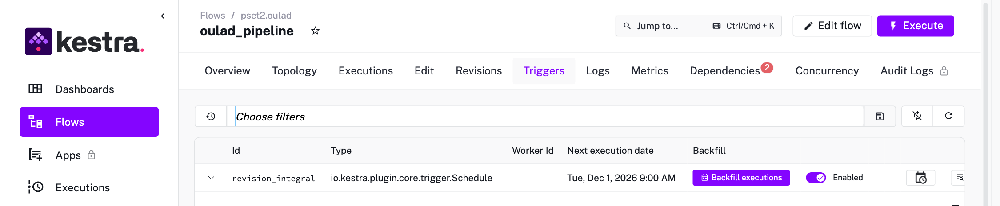
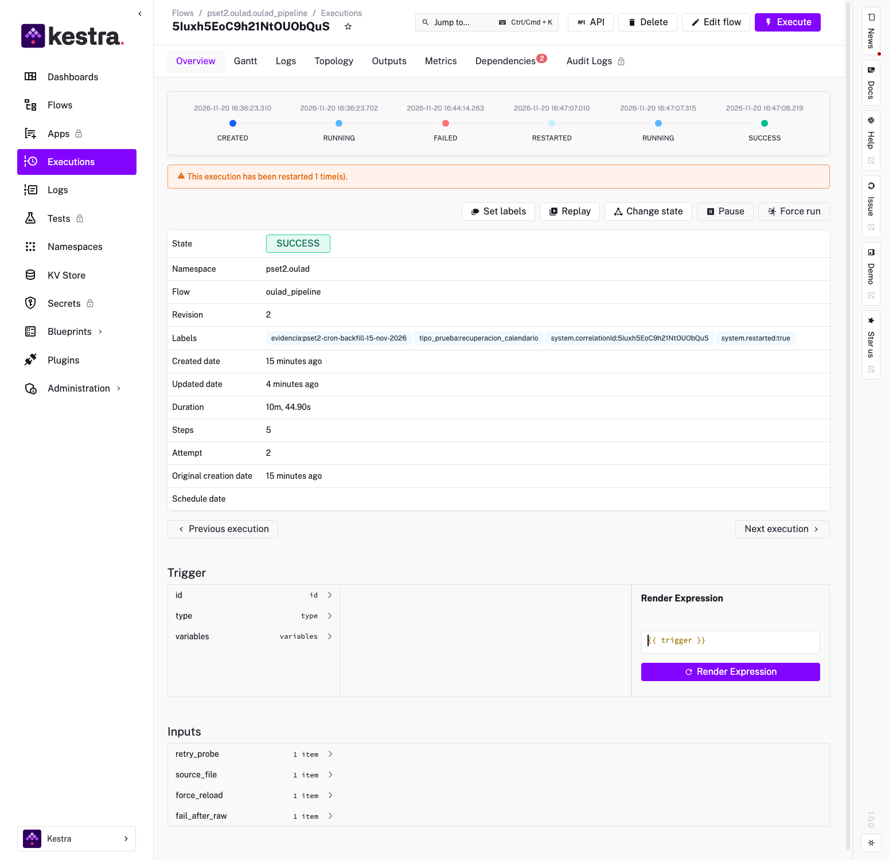

# Corrección Kestra: calendario y ejecución programada

Feedback recibido: «Activa el cron de los días 1 y 15 y presenta evidencia de la ejecución programada. Actualmente, el trigger está definido, pero deshabilitado».

## Configuración activa

| Elemento | Estado comprobado |
|---|---|
| Flujo padre | `pset2.oulad/oulad_pipeline`, revisión 2 |
| Trigger | `revision_integral`, `io.kestra.plugin.core.trigger.Schedule` |
| Cron | `0 9 1,15 * *`: días 1 y 15, 09:00 |
| Zona horaria | `America/Guayaquil` (UTC−05:00) |
| Estado YAML y API | Activo; `disabled: false` (la API puede omitir el valor false por defecto) |
| Raw | Subflujo; su calendario independiente permanece desactivado |
| Próxima ejecución registrada | 2026-12-01T09:00:00-05:00 |
| Infraestructura | Proyecto Compose `pset2-entrega`; Kestra `http://localhost:18090` |

El calendario se activó en el archivo y en la instancia real de Kestra de `pset_2/`. No se utiliza la carpeta histórica para esta ejecución. El flujo integrado de PSet 04 no tiene un segundo calendario sobre estas tablas; no ejecutar ambos escritores simultáneamente.



## Ejecución observada: recuperación del calendario

La fecha actual de la prueba fue 20-nov-2026. Para probar el calendario sin esperar al 1-dic ni alterar el reloj o el cron, se pidió un **backfill de Schedule** entre `2026-11-15T13:59:00Z` y `2026-11-15T14:01:00Z`: incluye exactamente el día 15 a las 09:00 Ecuador. En Kestra 1.0.0, su API instalada documenta `PUT /api/v1/main/triggers`; el cuerpo lleva `backfill.start`, `backfill.end`, inputs normales y etiquetas de la prueba. La versión actual de la documentación ofrece rutas posteriores; se comprobó el contrato instalado.

No se llamó a `POST /executions` para crear el padre. El planificador creó la ejecución y asignó el trigger Schedule. La petición administrativa de backfill fue explícita; **no se afirma que el equipo estuviera ejecutando el cron el 15 de noviembre ni que se observó su llegada en tiempo real**. Esto demuestra la recuperación de una fecha válida por el calendario activo. Una observación de un disparo ordinario futuro se incorporará cuando ocurra.

| Dato | Evidencia |
|---|---|
| Ejecución padre | `5Iuxh5EoC9h21NtOUObQuS` |
| Origen registrado | `io.kestra.plugin.core.trigger.Schedule` / `revision_integral` |
| Fecha programada | `2026-11-15T09:00:00-05:00` |
| Inicio real UTC | `2026-11-20T21:36:23.310269Z` |
| Fin real UTC | `2026-11-20T21:47:08.219764Z` |
| Resultado | `SUCCESS` |
| Raw | Cinco ficheros conciliados; 10,726,852 filas; checksum y NOOP preservados |
| dbt | 23 modelos, 168 pruebas aprobadas |
| Spark / OBT | 108,277 filas × 35 columnas; cuatro cortes y hashes previos idénticos |



La evidencia está en [JSON verificable](calendario-verificacion.json), [metadatos de ejecución](evidencia/pipeline/5Iuxh5EoC9h21NtOUObQuS/execution.json), [reconciliación completa](evidencia/pipeline/5Iuxh5EoC9h21NtOUObQuS/verification.json), [petición de recuperación sin credenciales](evidencia/calendario/solicitud-backfill.json) y las capturas directas de la interfaz. El backfill de calendario y `--force-reload` son distintos: aquí `force_reload=false`, sin forzar una nueva versión Raw.

### Incidencia y recuperación conservadas

Raw, gate, dbt y Spark terminaron al primer intento. El cierre encontró `OSError EIO` al leer el archivo de referencia `audit.json` montado desde el directorio sincronizado. Se repuso con los mismos bytes del archivo versionado (SHA256 `2524b786694db99144abc9a22fa23698290c82884926424b56b693a6aba5a8ff`) y se recreó solo Kestra para remontarlo. Después se reinició la tarea fallida mediante la API de restart: mismo ID y origen Schedule, dos intentos de verificar, sin repetir Raw/dbt/Spark. Fue una recuperación manual; no se presenta como un éxito al primer intento ni como un retry automático. Se conserva el [estado FAILED previo](evidencia/pipeline/5Iuxh5EoC9h21NtOUObQuS/antes-reintento-execution.json) y la [verificación fallida previa](evidencia/pipeline/5Iuxh5EoC9h21NtOUObQuS/antes-reintento-verification.json).

## Comprobar y operar

Desde `pset_2/`, con la configuración privada existente:

```sh
python3 kestra/scripts/infra.py up --cloud
python3 kestra/scripts/ejecutar_pipeline.py --deploy
python3 kestra/scripts/ejecutar_pipeline.py --resume-execution 5Iuxh5EoC9h21NtOUObQuS
python3 kestra/scripts/verificar_calendario.py --execution-id 5Iuxh5EoC9h21NtOUObQuS
```

El último comando solo consulta API y evidencia; no crea ejecuciones ni cambia el calendario. Para revisar visualmente: abrir Kestra en `http://localhost:18090`, seleccionar el namespace y flujo padre, pestaña **Triggers**, confirmar **Enabled** y la siguiente fecha. En **Executions**, abrir el ID anterior; revisar SUCCESS, trigger y sus variables `date`, `previous` y `next`.

Para una recuperación deliberada desde la interfaz, **Backfill executions** permite elegir inicio/fin y etiquetas. Revisar antes que el intervalo incluya solo las fechas deseadas y que no haya otro escritor activo; la recuperación consume cómputo cloud aunque Raw responda NOOP. No es necesario repetirla para revisar esta evidencia. Nunca activar también el calendario independiente de Raw.

## Límites y continuidad

La próxima fecha solo se ejecutará si equipo, Docker, Kestra y recursos/credenciales cloud están disponibles. No se contrató un servidor permanente. El horario es dos veces por mes, no cada catorce días. OULAD es estático; el cron automatiza conciliación y transformación, no garantiza datos nuevos ni una actualización del proveedor. No se cuantificó costo monetario ni se entrenaron modelos.

El [memo actualizado](PSet2_memo_Puerta_Wilmer.pdf) mantiene seis páginas; [fuente](memo-pset2.md) y [registro de revisión](memo-revision-calendario.json) identifican el cambio. El [original aprobado](historial/PSet2_memo_Puerta_Wilmer_13nov2026.pdf) permanece intacto. Los informes de pruebas anteriores conservan sus fechas y el estado desactivado que tuvieron entonces.

Referencia del mecanismo: [Schedule y recuperación mediante backfill, documentación oficial de Kestra](https://kestra.io/docs/workflow-components/triggers/schedule-trigger). Las dos capturas son vistas reales de la instancia local, sin recreaciones gráficas.
