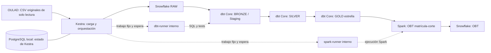

# Arquitectura de trabajo del PSet 2

Estado: cadena completa comprobada desde Kestra hasta OBT; reproducción desde exportación limpia verificada; memo técnico generado según [guía](memo-tecnico.md); revisión final pendiente. Diagnóstico local y conexión Python a Snowflake completados el 12-nov-2026. PostgreSQL, Kestra y Spark están desplegados y saludables; la imagen dbt se construyó y comprobó. Ingesta Raw ejecutada desde Kestra y verificada; Bronze/Staging ejecutado con 45 tests aprobados; Silver ejecutado con consolidación y 101 tests Bronze/Silver aprobados; Gold también está construido con 168 tests Bronze/Silver/Gold aprobados; Spark/OBT también está ejecutado y verificado.

## Componentes y responsabilidades

El diagrama muestra el flujo objetivo: CSV, Kestra, Raw y dbt Bronze/Silver/Gold ya se comprobaron; Spark/OBT también se ejecutó y verificó. El motor Spark local sí pasó una prueba de funcionamiento, distinta de construir OBT.

| Componente | Ubicación | Responsabilidad |
|---|---|---|
| Kestra | Docker local | Ingesta automática, dependencias, trigger, retries y backfill |
| PostgreSQL | Docker local | Metadatos persistentes de Kestra, separados de los datos analíticos |
| dbt Core y adaptador Snowflake | Imagen Docker reproducible | Tipado, limpieza, modelos, estrella y tests en Snowflake |
| dbt-runner / spark-runner | Red interna Compose, sin puertos publicados | Recibir trabajos fijos de Kestra, serializarlos y devolver estados/agregados; mismas imágenes de clientes |
| Spark | Docker local | Leer Gold, calcular features por corte y escribir OBT en Snowflake |
| Snowflake | Cuenta del autor | Persistir Raw, Bronze, Silver, Gold y OBT |

Se elige dbt Core en Docker para que el código y las dependencias del transformador formen parte de la reproducción local. PostgreSQL es un servicio auxiliar para Kestra; no reemplaza Snowflake como destino. Los comandos dbt y Spark ya funcionan por separado y desde el flujo integral Kestra; no se requiere intervención manual entre etapas. Ver orquestacion-integral.md.

## Recursos y despliegue gradual

El motor local reportó Linux x86_64, 4 CPU y 8.323.649.536 bytes de memoria, aproximadamente 7,8 GiB. Estos recursos describen el entorno actual, no garantizan capacidad suficiente. Iniciar y medir servicios gradualmente; evitar trabajos pesados simultáneos de Spark, dbt e ingesta. El diagnóstico registró unos 39,7 GiB libres en el host. La ocupación real de imágenes, volúmenes y temporales se medirá antes de establecer mínimos reproducibles.

Kestra y su base tendrán volúmenes persistentes. Spark usará almacenamiento temporal separado de los originales. Montar ../datasets desde pset-02 como solo lectura en el servicio que ingiere los CSV. Definir puertos locales explícitos y evitar exponer interfaces fuera de localhost durante el desarrollo.

## Versiones y autenticación

El cliente local de diagnóstico tiene conector Python 4.7.4 y dependencias fijadas. Las imágenes locales están fijadas y probadas según versiones-infraestructura.json; la conexión cloud del ejecutor Kestra ya se verificó; la de dbt también está comprobada; la de Spark también está comprobada. La combinación Kestra–PostgreSQL y el motor Spark/Scala/Java pasaron pruebas locales. El conector Spark–Snowflake y JDBC ya se fijaron por hash y probaron; ver spark-dependencias.json. Las imágenes locales ya están fijadas por versiones y digests reales. La documentación consultada orienta la selección, pero no demuestra compatibilidad de una combinación no probada.

Se consultaron candidatos con tags explícitos y manifiestos linux/amd64 en el registro Docker. El [registro de versiones](versiones-infraestructura.json) conserva sus digests por plataforma. La combinación pasó pruebas locales de salud, persistencia, ejecución de un flujo Kestra, trabajo Spark e instalación dbt. Consultar infraestructura-local.md para comandos y limitaciones.

El autor confirmó cuenta Snowflake y permisos administrativos. Existe evidencia de PSET2_OULAD, PSET2_WH y PSET2_PIPELINE. La conexión externa de PSET2_SVC por par de claves pasó la prueba de contexto del cliente Python. La privada permanece fuera del repositorio; los contenedores cloud la montan como solo lectura. Mantener en Git únicamente plantillas y referencias a configuración local, sin valores reales de autenticación. La prueba inicial del host no acreditaba conexión desde dbt o Spark. Posteriormente se comprobó dbt y se construyó Bronze; ver calidad-bronze.md. La conexión del ejecutor Kestra se comprobó posteriormente y se utilizó para Raw, con montajes privados en solo lectura.

## Criterios para dar la infraestructura por terminada

1. Compose válido, imágenes identificadas y servicios saludables.
2. Persistencia de Kestra comprobada después de reiniciar servicios.
3. Acceso a CSV en solo lectura y hashes reconciliados dentro del consumidor.
4. Clientes dbt y Spark con versiones verificadas y conexión mínima a Snowflake.
5. README con comandos exactos para levantar, comprobar, ejecutar y detener.
6. Secretos locales excluidos de Git y evidencias sin credenciales.

## Referencias de implementación

- [Kestra: Docker Compose con PostgreSQL](https://kestra.io/docs/installation/docker-compose).
- [dbt: conexión con Snowflake](https://docs.getdbt.com/docs/local/connect-data-platform/snowflake-setup). Elegir la documentación de la versión de dbt que se instale.
- [Snowflake: instalación del conector Spark](https://docs.snowflake.com/en/user-guide/spark-connector-install).

Referencias consultadas el 12-nov-2026. El flujo y los criterios específicos de OULAD derivan del enunciado y del contrato de datos del proyecto.
