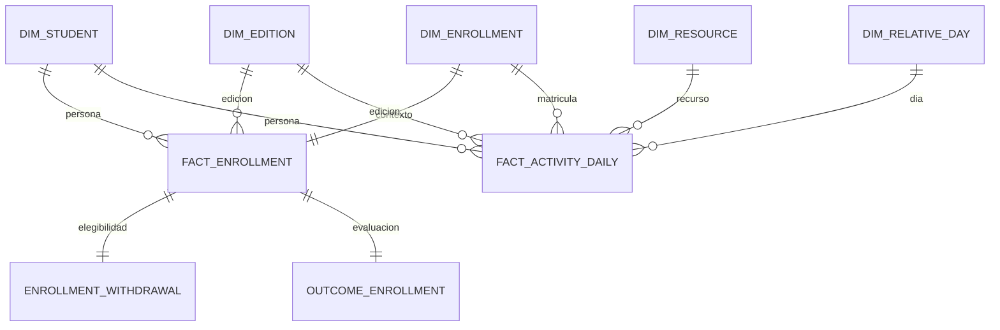

# Contrato preliminar de datos v1

Estado: Raw ya se construyó y reconcilió desde Kestra según ingesta-raw.md. Bronze tipado y perfil global de calidad ejecutados; ver calidad-bronze.md y calidad-bronze-resultados.md. Silver también está implementado según silver.md y silver-resultados.md. Gold también está implementado según gold.md. La OBT ya se construyó según obt-spark.md; orquestación completa ya verificada; reproducción desde exportación limpia verificada según reproduccion-limpia.md.

## Grano, población y tiempo

Matrícula: (id_student, code_module, code_presentation). Edición: (code_module, code_presentation). Recurso: (id_site, code_module, code_presentation). Evento fuente: matrícula + id_site + date, con multiplicidad global comprobada: 2.195.960 filas adicionales respecto de claves distintas; no es único antes de consolidar. Bronze conserva el grano técnico SHA-256 + número de fila fuente. OBT: matrícula + cutoff_day en {14,28,42,56}, hasta cuatro filas por matrícula. Día 0 es inicio oficial y el corte incluye el final del día. Registro <= 0 y no nulo define población inicial; registro ausente se excluye con conteo. Elegibilidad excluye retiro <= corte; no consulta retiro futuro para formar predictores.

Construir población elegible antes de agregar/unir actividad y preservar matrículas sin clics mediante left joins. Predictores usan solo información <= corte. El target final, retiradas futuras y resultados finales van a una tabla separada para evaluación retrospectiva. Una exportación de características utilizará lista permitida explícita y test de ausencia de target/fecha futura. Sin notas de assessments en la comparación principal.

Ventanas comparables: días 1–14, 15–28, 29–42, 43–56. Día 0 y actividad negativa se conservan como antecedentes de actividad separados, sin mezclarlos con quincenas de 14 días. Acumulados pueden incluirlos con nombre explícito. Recencia usa última interacción <= corte; nunca activos con cobertura acreditada cuentan desde día 0; cobertura desconocida se marca y exige política común fijada antes de prueba. Primer corte sin cambio entre dos quincenas completas. Validar fechas y recursos disponibles por edición antes de imponer rangos. La documentación de semanas de recursos no prueba cobertura exhaustiva de logs.

## Silver implementado: contrato v1

Se mantienen todas las matrículas y recursos. SLV_ENROLLMENTS contiene antecedentes y una bandera de IMD ausente; SLV_REGISTRATION conserva fechas y estado de registro inicial, sin resultado final. SLV_OUTCOMES concentra etiquetas y banderas retrospectivas. Estas banderas no forman parte de la población ni de las features. SLV_ACTIVITY_DAILY consolida matrícula–recurso–día mediante SUM(sum_click), conservando SOURCE_ROW_COUNT y linaje reconstruible desde Bronze; no aplica deduplicación exacta. Se preservan 39.605.099 clics en 8.459.320 claves diarias. La sensibilidad a eliminar observaciones idénticas se mide aparte, sin aplicarla.

Registro inicial conocido <= 0: 32.314 matrículas. Silver conserva el registro; la elegibilidad por corte se materializó después en OBT, excluyendo retiros conocidos hasta el corte y contando ausencias/registro tardío. Las 3.365 matrículas sin actividad se conservan en antecedentes, sin afirmar cobertura exhaustiva de logs. [Implementación, pruebas y límites](silver.md).

## Estrella Gold implementada: contrato v1

| Tabla | Grano y uso |
|---|---|
| dim_student | Persona anonimizada; solo identidad |
| dim_enrollment | Matrícula; antecedentes variables por matrícula, sin resultados ni retiro |
| dim_edition | Módulo–edición; duración, sin inventar calendario |
| dim_resource | Recurso por módulo–edición |
| dim_relative_day | Día relativo continuo, con negativos, cero y cuatro cortes |
| fact_enrollment | Matrícula, contador y registro inicial |
| fact_activity_daily | Matrícula–recurso–día, clics y linaje consolidados |
| enrollment_withdrawal | Matrícula y retiro registrado; solo elegibilidad as-of |
| outcome_enrollment | Matrícula y resultado final; evaluación retrospectiva |
| dq_gold_profile | Dataset–métrica; reconciliación y referencia poblacional |

Son dos estrellas con dimensiones compartidas. La estrella sirve para análisis reutilizable; la OBT construida con Spark servirá al modelo por matrícula–corte. La actividad conserva 8.459.320 claves diarias y 39.605.099 clics, también después de unir dimensiones. Los 168 tests de Bronze/Silver/Gold pasaron. No sumar matrículas, créditos o antecedentes repetidos al unir hechos sin agregación previa.

Referencia de elegibles por corte, consistente con PSet 1: 14=27.881; 28=27.307; 42=26.795; 56=26.294. Se usa registro conocido <= 0 y retiro ausente o posterior al corte, sin consultar resultados para seleccionar población. No es una OBT ni evidencia de features calculadas con Spark. Persisten las limitaciones de retiro sin fecha y cobertura. [Implementación y diagrama](gold.md), [resultados](gold-resultados.md).

## OBT implementada: contrato v1

Spark publica ANALYTICS.OBT_FEATURES con 108.277 filas y 35 columnas. El grano es matrícula–corte y se conserva la población esperada: 27.881, 27.307, 26.795 y 26.294 en cortes 14, 28, 42 y 56. Los alumnos sin actividad registrada se preservan; hay 1.582, 881, 684 y 576 casos sin registros hasta cada corte, respectivamente. Las tablas Gold de etiquetas y retiro no se incorporan como predictores.

Recencia es corte menos último día observado <= corte. Si no hay registros, permanece NULL; HAS_RECORDED_ACTIVITY y LOG_COVERAGE_KNOWN diferencian presencia de registros y cobertura, que continúa sin acreditar. Los contadores cero describen registros, no actividad académica real. Primer cambio entre quincenas NULL; razón NULL cuando el denominador no es positivo. No se ajustan imputaciones aprendidas en ELT.

El [contrato de columnas](../spark/feature-contract.json) separa identificadores, estáticas, actividad y auditoría. Se verificaron siete casos sintéticos, cuatro perturbaciones reales de actividad futura, igualdad de claves con una referencia SQL y lectura completa de vuelta antes de publicar. [Guía](obt-spark.md), [resultados](obt-resultados.md). Las garantías corresponden a la transformación implementada; disponibilidad institucional de todos los atributos y cobertura externa siguen siendo limitaciones.

## Transformaciones aprendidas y evaluación futuras

ELT calcula reglas deterministas y agregaciones por corte. Imputación aprendida, escalado, selección o codificación ajustada a distribución se aprenden solo con entrenamiento. Prueba temporal: etiquetas maduras antes de predicción simulada, alumnos separados, cortes de matrícula en una sola partición. Seleccionar pares de ediciones después de validar calendario; no se declara válida todavía una partición específica.

Tests: unicidad y no nulos de claves; relaciones completas; suma de eventos y clics Raw–Silver–Gold reconciliada con exclusiones; clases válidas; N elegible calculado independientemente igual a filas OBT por corte; anti-join de claves antes/después; ausencia de multiplicación en joins; matrículas sin actividad preservadas; perturbación de eventos futuros no cambia features pasadas; idempotencia de una partición. Cuantificar reglas fallidas y documentar tratamiento sin correcciones silenciosas.

Completitud mide presencia respecto a campos esperados, validez conformidad a dominios/rangos y consistencia coherencia entre tablas/reglas. Exactitud respecto a la realidad externa permanece sin demostrar sin evidencia adicional. Los nulos de retiro pueden representar continuidad, no faltante genérico.
