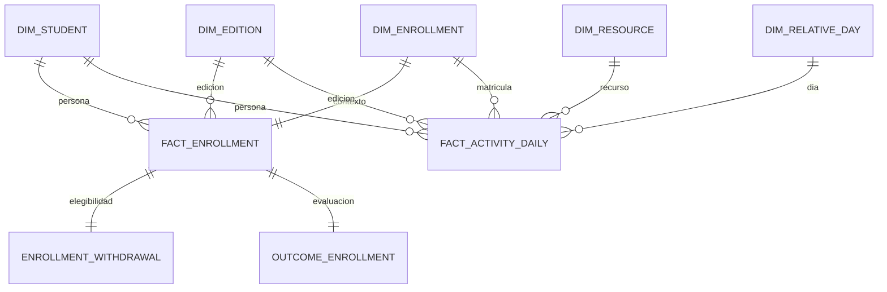

# Paso 7: esquema estrella Gold con dbt

Gold organiza los datos de Silver para consultas dimensionales y para la futura OBT. Define dos hechos con granos distintos y cinco dimensiones conformadas. Conserva todas las matrículas y la actividad diaria; no entrena modelos ni calcula aún features por corte con Spark.

## 1. Ejecutar y guardar evidencia

Desde la raíz, con Docker, Raw y la configuración privada existentes:

```bash
python3 pset-02/scripts/ejecutar_dbt.py parse
python3 pset-02/scripts/ejecutar_dbt.py build-gold
python3 pset-02/scripts/ejecutar_dbt.py quality-export-gold
python3 pset-02/scripts/resumir_gold.py
```

build-gold ejecuta `dbt build --select tag:bronze tag:silver tag:gold`. Vuelve a validar las capas anteriores y crea las tablas GOLD a partir de ref(); Raw sigue intacto. Bronze usa source() para las tablas originales. Las dependencias, versiones, perfil y secretos son los mismos que en Silver: no se requiere instalar paquetes adicionales ni volver a introducir credenciales.

quality-export-gold consulta únicamente DQ_GOLD_PROFILE y guarda agregados en docs/calidad-gold.json. El resumen Markdown se genera desde ese JSON y el informe dbt, sin editar cifras manualmente. Los logs y artefactos completos permanecen en .local/dbt, excluido de Git; los informes públicos contienen campos permitidos. Ejecutar un único escritor y no cargar Raw mientras se construyen estas capas.

Ejecución comprobada: diez tablas Gold y **168 tests aprobados** de las tres capas, incluidos 67 de Gold. [Resultados](gold-resultados.md), [build dbt](dbt-build-gold.json), [métricas](calidad-gold.json) y [SQL de revisión](../snowflake/07_verificar_gold.sql). Los informes usan UTC. Las primeras pruebas standalone fueron el 12-nov local; la ejecución integral posterior se verificó el 13-nov local.

## 2. Grano y tablas implementadas

| Tabla en GOLD | Grano | Contenido y uso |
|---|---|---|
| DIM_STUDENT | Persona anonimizada | Solo id_student; identidad común entre matrículas |
| DIM_EDITION | Módulo–edición | Códigos y duración; no inventa fechas de calendario |
| DIM_RESOURCE | Recurso por módulo–edición | Tipo de actividad, semanas conocidas y bandera de calendario desconocido |
| DIM_ENROLLMENT | Matrícula | Contexto demográfico/académico observado para esa matrícula y bandera IMD |
| DIM_RELATIVE_DAY | Día relativo | Rango continuo de actividad, día cero, preinicio, ventanas tempranas y cortes |
| FACT_ENROLLMENT | Matrícula | Enrollment_count=1, registro inicial y claves a persona, edición y contexto |
| FACT_ACTIVITY_DAILY | Matrícula–recurso–día | Clics, filas fuente representadas y linaje de consolidación |
| ENROLLMENT_WITHDRAWAL | Matrícula | Fecha de retiro registrada para elegibilidad histórica; separada de predictores |
| OUTCOME_ENROLLMENT | Matrícula | Etiquetas finales y banderas retrospectivas de inconsistencia |
| DQ_GOLD_PROFILE | Dataset–métrica | Reconciliación, efecto de joins y referencia de población por corte |

Las claves de matrícula, recurso y edición reutilizan las claves canónicas de Silver. Se prueban como únicas y no nulas en las dimensiones y como relaciones en los hechos. No se generan secuencias que cambien entre ejecuciones. La clave natural anonimizada identifica DIM_STUDENT; no es una identidad real ni un mecanismo de autorización.

DIM_ENROLLMENT evita sobrescribir atributos de una matrícula con valores de otra. Educación, créditos, IMD y otros antecedentes no se resuelven eligiendo el registro más reciente de la persona: eso podría traer información de una edición posterior. DIM_STUDENT conserva únicamente identidad, sin conteos de matrículas futuras ni etiquetas agregadas. No se implementa un historial SCD inventando fechas de vigencia que no ofrece la fuente.

## 3. Diagrama dimensional



Son dos estrellas que comparten dimensiones, una constelación dimensional. Los hechos se consultan directamente con sus dimensiones, sin necesitar unir primero un hecho al otro. Retiro y resultados son tablas complementarias con un propósito explícito; no se incorporan al hecho de actividad ni a los antecedentes.

## 4. Medidas, joins y aditividad

CLICK_COUNT es aditivo sobre las filas diarias según la política Silver de suma de todas las contribuciones. SOURCE_ROW_COUNT permite reconciliar con las filas originales. Se conserva la incertidumbre semántica sobre observaciones idénticas y el análisis de sensibilidad previo; Gold no cambia esa política.

ENROLLMENT_COUNT se suma sobre FACT_ENROLLMENT para contar matrículas. No se suma después de unir ese hecho directamente con los millones de filas de actividad: cada matrícula se repetiría por recurso y día. Para combinar ambos hechos, agregar primero la actividad al grano matrícula o matrícula–corte y después usar left join desde la población de matrículas. Lo mismo se aplica a los créditos y otros atributos del contexto: no son clics aditivos.

Los tests verifican que el join de actividad con las cinco dimensiones mantiene filas y clics por edición. También comprueban correspondencia de persona/edición entre contexto, recurso y hecho: una FK válida por separado no basta para garantizar que las claves pertenezcan a la misma edición. Las matrículas sin actividad se conservan en FACT_ENROLLMENT y DIM_ENROLLMENT.

## 5. Tiempo relativo, registro y resultados

DIM_RELATIVE_DAY cubre continuamente desde el mínimo observado de actividad, incluyendo cero, hasta el máximo observado o el corte 56, lo que sea mayor. Incluye días sin registros de actividad. Es un índice relativo, no un calendario institucional ni prueba de cobertura de logs. Las fechas de registro y retiro se mantienen como días relativos independientes; no son FK a este rango de actividad.

IS_OBSERVATION_CUTOFF identifica 14, 28, 42 y 56. EARLY_WINDOW_INDEX clasifica 1–14, 15–28, 29–42 y 43–56; el día cero y negativos permanecen separados. Las features de recencia, ventanas y cambios se implementarán después con Spark, filtrando información disponible hasta el corte.

FACT_ENROLLMENT contiene fecha de registro y su clasificación, sin fecha de retiro ni resultado. ENROLLMENT_WITHDRAWAL permite evaluar `registro conocido <= 0` y `retiro ausente o > corte`. No se usa la fecha de retiro posterior como predictor. Las 93 etiquetas Withdrawn sin fecha de retiro siguen siendo una limitación: no se inventan fechas ni se usa la etiqueta para excluir retrospectivamente casos de la selección operativa.

OUTCOME_ENROLLMENT permite evaluación retrospectiva con Fail, Withdrawn y Approved. La separación se comprueba con listas permitidas de columnas en hechos y antecedentes; no constituye aislamiento de permisos del rol del pipeline. La OBT implementada después tiene su propia lista permitida y pruebas de actividad futura; ver obt-spark.md. La evaluación predictiva sigue pendiente.

DQ_GOLD_PROFILE calcula una referencia agregada de elegibles por corte sin consultar etiquetas en ese cálculo. El generador la compara con la auditoría independiente del PSet 1. Esa referencia no es todavía una OBT ni un conjunto de features: servirá para comprobar que Spark conserva la población esperada.

## 6. Pruebas y repetición

Las pruebas incluyen not_null, unique, relationships, claves completas antes/después, reconciliación Silver–Gold por edición, conteos de etiquetas y conservación al unir dimensiones. La dimensión de día debe ser continua y contener los cuatro cortes. Las listas permitidas impiden añadir por accidente resultados o retiro a las tablas de antecedentes y hechos.

Para ejecutar solamente pruebas Gold sobre tablas ya construidas existe:

```bash
python3 pset-02/scripts/ejecutar_dbt.py test-gold
```

Después de cambiar Raw, usar build-gold y exportación. dbt crea/reemplaza tablas completas; no acumula filas incrementalmente. La materialización es atómica por modelo, no una transacción de todas las capas: no consumir un build fallido como si estuviera completo.

Para medir repetición después de un build y exportación exitosos:

```bash
python3 pset-02/scripts/comprobar_repeticion_gold.py checkpoint
python3 pset-02/scripts/ejecutar_dbt.py build-gold
python3 pset-02/scripts/ejecutar_dbt.py quality-export-gold
python3 pset-02/scripts/comprobar_repeticion_gold.py verify
python3 pset-02/scripts/resumir_gold.py
```

Se comparan métricas agregadas y aprobación de tests de dos builds distintos. El resumen solo acredita repetición para el build correspondiente; una reproducción nueva puede generar el resumen dejando esa prueba pendiente. No modificar Raw entre ambas mediciones.

Se ejecutó el procedimiento: ambos builds aprobaron 168 tests y mantuvieron las mismas 26 métricas agregadas. [Informe de repetición](repeticion-gold.json).

## 7. Uso de estrella y futura OBT

La estrella permite reutilizar dimensiones para analizar clics por actividad, edición y día, o matrículas por contexto. Conserva granos explícitos y evita repetir todos los atributos en cada evento. La OBT implementada después con Spark es una tabla de consumo predictivo por matrícula–corte: hasta cuatro filas elegibles, con agregaciones disponibles al corte y una lista explícita de predictores. Los acumulados entre cortes no se suman como hechos independientes.

Gold ocupa almacenamiento adicional y sus pruebas utilizan PSET2_WH con dos hilos dbt. No se ha cuantificado costo monetario. Spark ya se conectó y construyó/verificó la OBT: [guía](obt-spark.md), [resultados](obt-resultados.md). La orquestación completa ya se verificó: [guía](orquestacion-integral.md), [resultados](pipeline-resultados.md).

Referencias técnicas: [dbt: modelo dimensional con hechos y dimensiones](https://docs.getdbt.com/blog/kimball-dimensional-model) y [Snowflake: rango entero para la dimensión relativa](https://docs.snowflake.com/en/sql-reference/functions/array_generate_range). Los granos y las decisiones concretas de OULAD son los de este proyecto.
