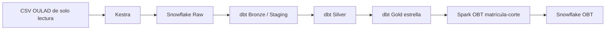

# Plan de implementación y seguimiento

Este documento conserva la secuencia de trabajo. Ya se verificaron recursos Snowflake y conexión desde el host, servicios Docker locales, instalación dbt, un flujo Kestra y un trabajo Spark de comprobación. La ingesta Raw, reejecución, retry controlado y backfill por fichero ya se probaron. Bronze/Staging ya se ejecutó: cinco vistas, un perfil agregado y 45 tests aprobados; Silver también se ejecutó: siete tablas, consolidación aditiva y 101 tests Bronze/Silver aprobados. Gold también se construyó: diez tablas y 168 tests Bronze/Silver/Gold aprobados. Spark/OBT ya se ejecutó; orquestación completa verificada; reproducción desde exportación limpia verificada; ver reproduccion-limpia.md. Ver calidad-bronze.md, silver.md y gold.md. Para Raw se eligió partición fichero/checksum completo, en lugar de módulo–edición del diseño preliminar, para publicar cada fuente de forma atómica; la limitación se explica en ingesta-raw.md. El estado actual y sus límites se registran en estado-ejecucion.md e infraestructura-verificacion.json. El [memo técnico](memo-tecnico.md) ya se generó en seis páginas desde su fuente Markdown, con cifras de la implementación comprobada.

## Arquitectura prevista

Se propone dbt Core en Docker para versionar transformaciones junto a Kestra y Spark. Confirmar compatibilidad del adaptador Snowflake, conectores JVM, versiones de Java y Python al implementar. La infraestructura local ya tiene versiones/digests y dependencias dbt resueltas por hash; conexión cloud de Kestra probada, conexión dbt comprobada; conexión y conector Spark también comprobados; ver obt-spark.md. No utilizar latest como prueba de reproducibilidad.

## Secuencia y criterios concretos

1. Registrar Docker Engine/Compose, arquitectura del equipo y recursos disponibles; medir CPU, memoria y disco con los 10.655.280 registros de actividad antes de fijar mínimos. Fijar imágenes por versión/digest y probar salud de Kestra y Spark, persistencia y reinicio. Crear docker-compose.yml solo con servicios implementados y verificados.
2. Resolver OULAD_DATA_DIR=../datasets desde pset-02/. Montar explícitamente solo lectura, comprobar hashes dentro del contenedor y prohibir escritura sobre originales. Configurar secretos locales sin imprimirlos. Definir rol mínimo, warehouse, base y esquemas en Snowflake con instrucciones de creación, privilegios y dependencias cloud verificadas. Docker no reproduce Snowflake.
3. Carga inicial manualmente disparada por ejecución autenticada; futuras ejecuciones quincenales solo comprueban cambios de manifiesto. OULAD es estático: misma huella produce no-op o reemplazo determinista, no nuevos datos inventados. Programar trigger y zona horaria documentados al implementar.
4. Kestra valida archivos, registra run_id, checksum, filas, partición módulo–edición y estado. Diseñar tres reintentos con espera exponencial para fallos transitorios; errores de esquema/calidad fallan sin publicación. Backfill por archivo/edición con checkpoints y reconciliación, reanudando solo particiones fallidas. Logs sin secretos.
5. Raw conserva carga fiel, metadatos y linaje. Usar staging temporal y publicación transaccional o MERGE por claves acordadas. Reejecutar misma huella/partición debe conservar conteos y unicidad. Una nueva huella se registra como versión, nunca se mezcla silenciosamente.
6. dbt source() para Raw y ref() para dependencias. Bronze/Staging tipa y marca anomalías, Silver aplica limpieza justificada y Gold construye estrella. Tests not_null, unique compuesta, relationships, clases, fechas contextuales y cardinalidad. Registrar tabla problema–evidencia–acción–justificación con métricas reales, evitando copiar los ejemplos 120 y 4.3 %.
7. Spark construye OBT desde población elegible antes de unir agregados de actividad, usando left joins. Comparar claves y filas antes/después, preservar ceros y distinguir cobertura desconocida. Escribir OBT en Snowflake por matrícula–corte con control de cargas.
8. Desde clon limpio: obtener datos identificados, verificar hashes, crear entorno/credenciales y recursos cloud documentados, levantar servicios fijados, comprobar salud, ejecutar Raw, dbt y Spark en orden, verificar tablas y evidencias. Repetir carga para demostrar idempotencia, simular fallo y backfill, y guardar logs sanitizados y resultados de tests.

## Calidad y publicación

Completitud: proporción no nula de campos requeridos, por fuente y edición. Validez: conformidad de tipos, dominios y rangos contextuales. Consistencia: relaciones entre fuentes, unicidad, conteos y coherencia temporal. Precisión/exactitud externa requiere cotejo con realidad o proveedor y no se demuestra copiando fielmente un CSV. No deduplicar sin evidencia de grano y regla justificable. Las anomalías aún no resueltas se publican como limitaciones.

## Batch, costo y operación

Batch basta para revisión quincenal y un histórico estático. Streaming se justificaría con fuente institucional continua y necesidad demostrada de reacción de baja latencia, antes de rediseñar contratos y operación; no se implementará ahora. En ejecución futura medir consumo y costo Snowflake, fijar auto-suspend y auto-resume, limitar warehouse, detener servicios y limpiar recursos temporales conservando evidencia. No se afirma gratuidad ni consumo comprobado.
