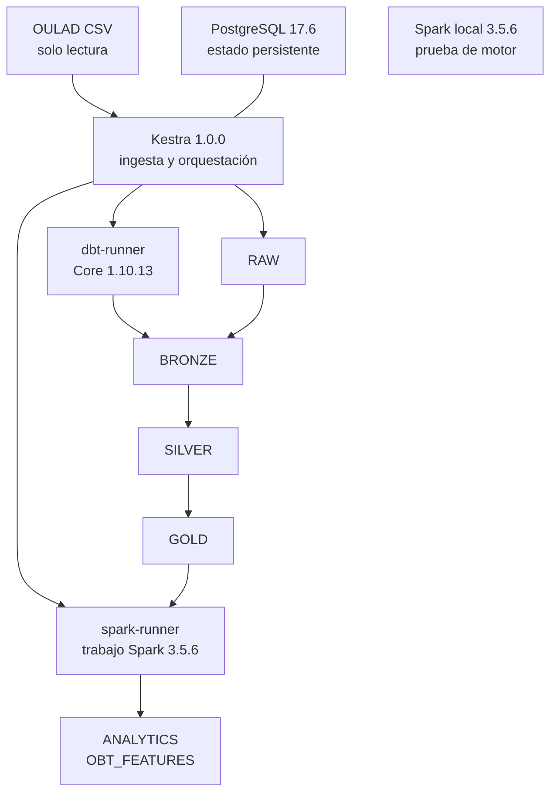
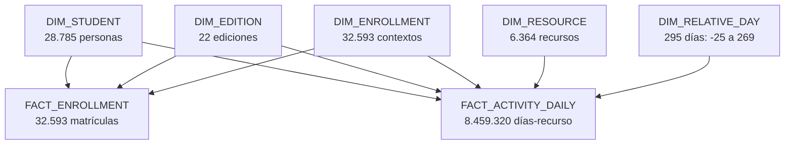

# Pipeline reproducible para apoyo académico con OULAD

Wilmer Puerta | PSet 2 | 13 de noviembre de 2026

## 1. Arquitectura implementada

El pipeline prepara datos para evaluar, en una universidad hipotética, la detección temprana de futuras reprobaciones con cupos limitados de revisión. Continúa el PSet 1 y termina en datos preparados; no entrena modelos ni demuestra impacto educativo. La ejecución integral y su reproducción limpia terminaron correctamente [E4, E5].



Figura 1. Contenedores locales arriba; persistencia analítica en PSET2_OULAD abajo. Las flechas entre esquemas representan dependencias de datos. dbt ejecuta SQL en Snowflake; Spark calcula la OBT en modo local[2]. El servicio Spark de diagnóstico es distinto del ejecutor cloud.

| Resultado comprobado | Volumen |
|---|---:|
| Raw: cinco fuentes reconciliadas | 10.726.852 filas |
| Silver y Gold: actividad diaria | 8.459.320 filas |
| dbt: tres capas | 23 modelos; 168 pruebas aprobadas |
| OBT publicada | 108.277 filas; 35 columnas |

Compose define cinco servicios persistentes o disponibles: PostgreSQL, Kestra, Spark, dbt-runner y spark-runner; dbt también tiene un servicio puntual. Kestra espera Raw, dbt y Spark en ese orden y verifica el resultado. Los ejecutores internos admiten trabajos fijos, reutilizan solicitudes repetidas y no exponen comandos arbitrarios ni el socket Docker.

Las imágenes base están fijadas por digest; Python y JAR tienen versiones y hashes. Se probaron Linux amd64, 4 CPU y unos 7,8 GiB asignados a Docker. Solo Kestra publica puertos en localhost. La clave cifrada y la configuración Snowflake permanecen fuera del repositorio, montadas en solo lectura; los archivos .env privados están excluidos de Git. El rol de ejecución usa permisos del proyecto, sin ACCOUNTADMIN.

<!-- pagebreak -->

## 2. Ingesta, recuperación y operación

La fuente es OULAD, histórico académico 2013-2014 de The Open University, con licencia CC BY 4.0 [R1]. Se consumen cinco CSV originales; evaluaciones y notas de evaluaciones quedan fuera del alcance. El manifiesto local identifica bytes, filas y SHA-256; la fecha original de descarga es desconocida. No acredita por sí solo autenticidad frente al proveedor.

| Archivo | Grano original | Filas |
|---|---|---:|
| studentInfo.csv | Estudiante en módulo-edición | 32.593 |
| studentRegistration.csv | Registro/retiro de matrícula | 32.593 |
| courses.csv | Módulo-edición | 22 |
| vle.csv | Recurso en módulo-edición | 6.364 |
| studentVle.csv | Aporte de actividad por matrícula-recurso-día | 10.655.280 |

Kestra ejecuta la validación del manifiesto, cabecera, anchura y conteos antes de cargar. Raw conserva campos originales como VARCHAR, incluidos vacíos, y añade SHA de fuente, número de fila, run_id y fecha de carga. Así se pueden rastrear conversiones sin alterar los CSV [E1].

La carga usa un stage y una tabla temporal gestionados. Tras COPY se comprueban filas, números de fila y versión de fuente; solo entonces una transacción reemplaza la fuente y registra LOADED. Un fallo revierte esa publicación. Si checksum y conteos ya coinciden, responde NOOP. Cinco NOOP comprobados no aumentaron los datos Raw; no se deduplica por claves de negocio.

### Frecuencia y backfill

El cron 0 9 1,15 * * programa los días 1 y 15 a las 09:00, America/Guayaquil. Tanto el calendario Raw como el padre están desactivados; se probó el disparo manual por API, no un disparo del reloj. La cadena no necesita intervención entre etapas. En un histórico estático, repetir no implica recibir datos nuevos.

El backfill probado recargó courses.csv completo, 22 filas, con --force-reload. La unidad de reposición es fichero/checksum, no módulo-edición. La reproducción limpia forzó después la recarga de los cinco CSV. Para otro histórico se requiere identificar la nueva versión y reconciliar sus resultados; esta implementación mantiene una versión vigente por fuente.

### Errores y evidencia de recuperación

Raw limita los intentos a tres y aplica espera exponencial de 5 a 30 segundos. Un fallo inyectado antes de conectar se recuperó al segundo intento. En la cadena padre, otra prueba controlada recuperó gate al segundo intento; la prueba permanente dejó FAILED y no inició dbt ni Spark [E4]. Estos ensayos prueban control de flujo, no una caída real de Snowflake.

El padre limita concurrencia a uno. Las solicitudes duplicadas a cada ejecutor reutilizan el mismo trabajo; tras reinicio un trabajo incompleto no se declara exitoso. Las operaciones manuales también deben respetar un solo escritor: no hay bloqueo global entre todos los puntos de entrada. La atomicidad es por carga, modelo o publicación OBT, no una transacción de todo el pipeline.

<!-- pagebreak -->

## 3. Calidad y decisiones de limpieza

Bronze/Staging usa source() sobre Raw y ref() entre modelos. Cinco vistas tipan los originales, convierten cadenas vacías a NULL y validan enteros sin redondear decimales; una tabla perfila calidad. Las conversiones inválidas fueron cero. Sus 45 pruebas validan claves, relaciones completas, dominios, linaje y conservación de filas [E2].

| Problema | Evidencia | Acción | Justificación |
|---|---|---|---|
| IMD incompleto | 1.111/32.593; 3,41 % | NULL y bandera | No inventar posición socioeconómica. |
| Registro desconocido o tardío | 45 sin fecha; 234 con día > 0 | Conservar y clasificar | No asumir disponibilidad al inicio. |
| Calendario de recursos ausente | 5.243/6.364; 82,39 % | NULL y bandera | No equivale a semana cero ni cobertura del log. |
| Retiro y resultado discrepantes | 93 Withdrawn sin fecha; 9 otros resultados con fecha | Banderas retrospectivas separadas | No inferir fecha desde el resultado final. |
| Claves diarias repetidas | 2.195.960 filas excedentes; 20,61 % | Sumar por matrícula-recurso-día | No se conoce si son copias erróneas o aportes válidos. |
| Valores idénticos repetidos | 787.170 filas excedentes; 7,39 % | Conservar contribuciones | Borrar coincidencias perdería clics sin respaldo externo. |

Los porcentajes de repetición usan 10.655.280 filas de actividad como denominador. Las 93 y 9 discrepancias corresponden a 32.593 matrículas. El perfil global posterior amplía la auditoría por bloques del PSet 1; no se sustituye retrospectivamente su evidencia [E2].

### Silver: consolidar sin borrar evidencia

Siete tablas separan ediciones, recursos, contexto de matrícula, registro, resultados, actividad diaria y calidad. La suma por módulo, edición, estudiante, recurso y día convierte 10.655.280 aportes en 8.459.320 claves diarias y conserva 39.605.099 clics. source_row_count reconcilia todas las filas; SHA y clave permiten volver a Raw. Los extremos de número de fila no implican un intervalo continuo.

Como sensibilidad, quitar repeticiones de valores exactos dejaría 38.343.063 clics: perdería 1.262.036, un 3,19 %. Es una alternativa cuantificada, no aplicada ni demostrada como corrección. La repetición de clave se resuelve cambiando el grano mediante agregación, no afirmando haber identificado duplicados erróneos.

Se conservan las 32.593 matrículas, incluidas 3.365 sin actividad. Los días negativos son válidos: Silver conserva 600.241 grupos de preinicio y 2.147.947 clics. No se imputan IMD, fechas ni semanas. Las 56 pruebas adicionales de Silver llevan el total a 101 y verifican conjuntos de claves, conteos, clics por edición y separación de resultados [E2].

La completitud se mide con faltantes y cobertura desconocida; la consistencia, con claves y reconciliaciones; la validez, con tipos, dominios y fechas relativas. La precisión/exactitud externa no es verificable sin registros de referencia: fidelidad al CSV y conversiones válidas no prueban que cada evento o atributo sea verdadero.

<!-- pagebreak -->

## 4. Gold: dos estrellas con granos explícitos

Gold contiene cinco dimensiones, dos hechos y tres tablas complementarias/de calidad. Las claves se derivan de las claves naturales de forma estable. DIM_STUDENT representa solo identidad; los atributos que pueden variar entre matrículas viven en DIM_ENROLLMENT. No se inventan calendarios exactos ni una historia de cambios no disponible [E3].



Figura 2. Flechas de dimensiones a hechos; cada referencia es muchos-a-uno desde el hecho. Las estrellas comparten persona, edición y contexto de matrícula. Las relaciones con recurso incluyen módulo-edición, evitando asociar recursos de otras ediciones.

| Tabla de hechos | Una fila por | Medidas y límites |
|---|---|---|
| FACT_ENROLLMENT | Módulo-edición-estudiante | enrollment_count = 1; registro conocido al inicio. |
| FACT_ACTIVITY_DAILY | Matrícula-recurso-día relativo | Suma de clics y aportes fuente; linaje conservado. |

ENROLLMENT_WITHDRAWAL conserva la fecha de retiro para elegibilidad al corte. OUTCOME_ENROLLMENT conserva el resultado original, la agrupación Approved/Fail/Withdrawn y banderas retrospectivas; no entra como predictor. DQ_GOLD_PROFILE resume las verificaciones. Esta separación es lógica y por contrato de columnas; el rol del pipeline puede leer esas tablas.

### Pruebas que protegen el análisis

Las 67 pruebas adicionales de Gold llevan el total a 168 en 23 modelos: 6 Bronze, 7 Silver y 10 Gold. Se usan not_null, unique, relationships y SQL de negocio para comparar conjuntos de claves, poblaciones y sumas por edición. Unir actividad con las cinco dimensiones mantiene 8.459.320 filas y 39.605.099 clics; también se valida el contexto de estudiante y edición.

Los clics son aditivos al grano diario. El conteo de matrícula y los créditos no se suman después de unir a actividad sin agregar: se multiplicarían por los eventos. Para combinar los hechos se agrega primero actividad al grano requerido y luego se une con matrícula. La estrella sirve para auditoría y análisis flexible por recurso, edición y tiempo; la OBT fija una observación y sus variables para el futuro modelado.

<!-- pagebreak -->

## 5. Spark y OBT: observar solo el pasado

Spark 3.5.6, Scala 2.12 y Java 17 leen Gold con conector Snowflake 3.2.3-spark_3.5 y JDBC 4.4.1 fijados por hash. El trabajo publica PSET2_OULAD.ANALYTICS.OBT_FEATURES: una fila por matrícula-corte, 108.277 claves únicas y 35 columnas [E3].

La población se calcula antes de unir actividad: registro conocido <= 0 y retiro ausente o posterior al corte. La ausencia de fecha de retiro se interpreta como ausencia de retiro registrado, sin inferirla desde el resultado. Los cortes son los días relativos 14, 28, 42 y 56. Un left join conserva elegibles sin actividad; las claves coinciden con una referencia SQL independiente y con el PSet 1.

| Día de corte | Matrículas elegibles / filas OBT | Sin actividad registrada |
|---|---:|---:|
| 14 | 27.881 | 1.582 |
| 28 | 27.307 | 881 |
| 42 | 26.795 | 684 |
| 56 | 26.294 | 576 |

### Variables y ventanas

El contrato separa 6 identificadores, 11 predictores estáticos, 16 de actividad y 2 campos de auditoría. Incluye antecedentes de matrícula, clics, días activos, recursos, tipos de actividad, foros, contenido, cambio entre quincenas y recencia. Identificadores y auditoría no son automáticamente predictores. Resultado final, target y fecha de retiro quedan fuera de las 35 columnas.

Para cada corte c se filtra actividad con día <= c. El acumulado incluye preinicio y día cero; la ventana actual es [c-13, c] y la anterior [c-27, c-14], esta última solo desde el corte 28. En el primer corte el cambio es NULL; la razón también lo es si el denominador previo no es positivo. La recencia es c menos el último día observado, o NULL sin eventos.

Los contadores ausentes pasan a cero como ausencia de registros observados. log_coverage_known sigue false: ese cero no demuestra ausencia real de actividad académica. No se ajustó imputación, escalado ni codificación aprendida. Tampoco se entrenó un modelo ni se estimó desempeño predictivo.

### Validación y publicación

Se leen 3.474.573 filas diarias con día <= 56 y se aplica otra vez el límite de cada corte. Siete casos sintéticos aprobaron elegibilidad y ventanas. Cuatro perturbaciones reales modificaron clics futuros e insertaron un evento posterior al corte: ninguna variable pasada cambió. Se comprobaron recencia no negativa, hasta 14 días activos por ventana y reconciliación de componentes temporales.

Antes de publicar se valida una tabla provisional, se lee de vuelta y se compara el DataFrame completo en ambos sentidos y en todas las columnas. El contrato impide reemplazar tablas ajenas; rename inicial o SWAP posterior publican la versión validada. Cuatro SHA-256 canónicos, uno por corte, coincidieron en repetición, orquestación y reproducción limpia. Los acumulados de diferentes cortes no se suman: repiten historia y tienen poblaciones distintas.

<!-- pagebreak -->

## 6. Reproducción, batch y límites

La reproducción 849681d33298 exportó 214 archivos versionables a otra carpeta, creó contraseñas, proyecto Compose, puertos 18080/18081 y volúmenes PostgreSQL/Kestra nuevos, y reconstruyó las tres imágenes propias con --no-cache. Ejecutó los cinco CSV como LOADED, 23 modelos, 168 pruebas y la OBT completa con las cuatro huellas previas idénticas [E5]. Después detuvo la copia y restauró saludable el stack principal.

Es una exportación limpia del árbol de trabajo, no un clon GitHub. Reutilizó imágenes base fijadas y la cuenta, rol, warehouse y esquemas Snowflake existentes; CSV y secretos se referenciaron externamente sin copiarlos. El manifiesto de exportación identifica la instantánea probada; el memo y los informes de cierre se agregaron después. No se afirma reproducción desde una cuenta cloud vacía.

### Cómo repetir el flujo

El README contiene el procedimiento completo: obtener los cinco CSV y verificar manifiesto; aprovisionar Snowflake; preparar claves y configuración privadas; preparar, construir y levantar Compose; desplegar y ejecutar Kestra. Los comandos siguientes se ejecutan desde la raíz, una vez preparada la configuración privada. El flujo integral ejecuta dbt y Spark sin intervención entre etapas [E6].

```bash
python3 pset-02/scripts/infra.py prepare
python3 pset-02/scripts/infra.py build --cloud
python3 pset-02/scripts/infra.py up --cloud
python3 pset-02/scripts/ejecutar_pipeline.py --deploy
python3 pset-02/scripts/ejecutar_pipeline.py
```

### Por qué batch; cuándo cambiaría

OULAD es un histórico estático, sin fuente continua de eventos. El caso propuesto revisa cupos de apoyo en cortes quincenales; no existe una necesidad validada de reaccionar en segundos. Batch permite reconstruir cortes, conciliar versiones y ejecutar controles antes de publicar. El calendario es una configuración operativa desactivada, no evidencia de actualización del histórico.

Streaming solo se justificaría con una fuente institucional continua y una intervención que demostrara necesitar menor latencia. Exigiría captura de eventos, reglas de tiempo de evento y llegadas tardías, deduplicación con identidad de evento, estado, seguridad y monitoreo de esa nueva fuente, y validación del beneficio frente al costo. No se implementó streaming.

### Limitaciones pendientes

Cobertura de logs y exactitud externa desconocidas; retiro sin fecha y ambigüedad de repeticiones; disponibilidad histórica de atributos no certificada por un sistema en vivo. Backfill solo por fichero, calendario sin activación, un solo escritor coordinado y sin transacción global. No se midió costo monetario; X-Small con auto-suspend de 60 s no implica gratuidad. El timeout del warehouse requiere evidencia específica. No se probaron ARM ni mínimos universales. No hay entrenamiento, validación prospectiva o impacto educativo. GitHub queda para el cierre autorizado.

### Referencias y evidencia verificable

R1. The Open University. OULAD: https://research.stem.open.ac.uk/ouanalyse/dataset/ y Kuzilek, Hlosta y Zdrahal (2017), DOI: 10.1038/sdata.2017.171. Manifiesto de esta copia: datasets/manifest.json.

E1. docs/ingesta-raw-verificacion.json. E2. docs/calidad-bronze.json y docs/calidad-silver.json. E3. docs/calidad-gold.json, docs/obt-verificacion.json y spark/feature-contract.json. E4. docs/pipeline-pruebas.json. E5. docs/reproduccion-limpia.json y output/reproduction/849681d33298/. E6. README.md. Rutas E1-E6 relativas a pset-02/. Fuente de este documento: memo-pset2.md.
